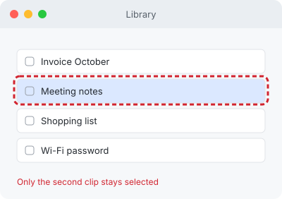
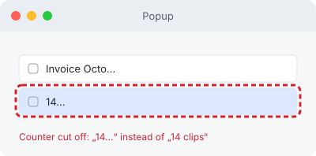
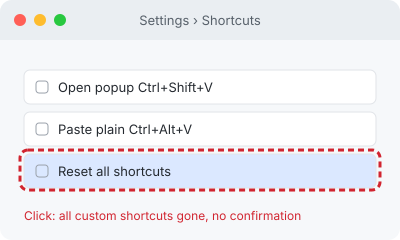

# Sample app – desktop (browser build)

8 items checked · 2 fix · 1 decide · 1 leave · 2 not checked

## Fix

| No. | Prio | Where | When | What you do | What happens | Should be | Why it matters | Fix | Proof |
|---|---|---|---|---|---|---|---|---|---|
| 1 | B | Main window › Library › Clip list | always | Click a clip → Hold Ctrl and click a second clip | only the second clip stays selected | both clips selected, like in Explorer or Finder | deleting or moving several clips only works through the small checkboxes | keep the selection on Ctrl-click, Shift-click selects a range |  |
| 2 | C | Popup › Footer › Clip counter | only while editing a clip | Open the popup → Open any clip for editing | footer shows "14…" | footer shows "14 clips" | the count is unreadable exactly when you need it | let the counter take the space of the hidden search hint |  |

## Decide

| No. | Prio | Where | When | What you do | What happens | Should be | Why it matters | Options | Proof |
|---|---|---|---|---|---|---|---|---|---|
| 3 | A | Settings › Shortcuts › Reset all shortcuts | always | Open Settings › Shortcuts → Click "Reset all shortcuts" | all custom shortcuts are gone immediately | a confirmation or an undo option | one misclick and there is no way back | a) confirmation dialog · b) undo toast for 10 s · c) leave it |  |

## Leave

| No. | Prio | Where | What | Why leave it |
|---|---|---|---|---|
| 4 | D | Settings › General › Language | Language picker shows "German" instead of "Deutsch" | common convention, mostly taste |

## Not checked

| No. | What | Why not | How you check it |
|---|---|---|---|
| 5 | Global shortcut Ctrl+Shift+V in another app | only in the real app | Popup opens over that app |
| 6 | Paste into another program | browser build has no system paste | Clip arrives in Notepad |
